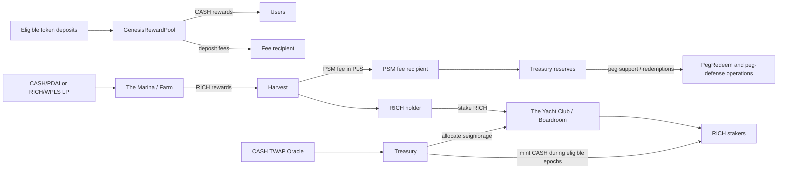

# Richie Finance contracts

Hardhat 3 / TypeScript repository for the Richie Finance protocol on PulseChain.
It contains the Solidity contracts, deployment and configuration scripts, and the
Mocha integration test suite.

- Website: [richie.finance](https://richie.finance)
- Documentation: [docs.richie.finance](https://docs.richie.finance/)
- Organisation: [github.com/Richie-Finance](https://github.com/Richie-Finance)
- Full deployment runbook: [DEPLOYMENT.md](./DEPLOYMENT.md)
- Deployment script notes: [scripts/tomb/README.md](./scripts/tomb/README.md)

> `Oracle.sol` intentionally remains Solidity 0.6 for compatibility with the
> existing TWAP implementation. The other protocol contracts target Solidity
> 0.8.20.

## Contract outline

| Contract | Role |
| --- | --- |
| `Peg.sol` | CASH token. Treasury-controlled minting and burning for the peg system. |
| `Share.sol` | RICH share token used for liquidity incentives, staking, and treasury allocations. |
| `GenesisRewardPool.sol` | Initial token pools that distribute the configured CASH reward allocation. Supports per-pool allocation and deposit fees. |
| `Farm.sol` | LP farms that distribute RICH over the farm schedule. RICH harvesting can charge the configured PSM fee in native PLS. |
| `Boardroom.sol` | RICH staking contract. Eligible stakers receive CASH seigniorage allocated by Treasury. |
| `Treasury.sol` | Epoch controller. Reads the CASH oracle, applies bootstrap/expansion tiers, mints CASH, and funds the Boardroom and configured funds. |
| `Oracle.sol` | Legacy Solidity 0.6 TWAP oracle for a PulseX pair. |
| `PegRedeem.sol` | Optional 1:1 CASH-to-PDAI redemption reserve. |
| `RebateCompositeOracle.sol` | Combines the RICH/WPLS and WPLS/DAI TWAP sources for rebate pricing without requiring a RICH/DAI LP. |
| `Rebates.sol` | Optional treasury rebate/vesting contract for configured PulseChain assets, including native PLS. |
| `Zap.sol` | PulseX V2 zaps for the PEG/PDAI and RICH/WPLS liquidity pairs. |

## Protocol flow



At a high level:

1. Users deposit eligible assets in Genesis or provide liquidity and stake LP
   tokens in the Farm.
2. Genesis distributes CASH; the Farm distributes RICH.
3. Farm harvests can collect the configured PSM fee in PLS. The fee is sent to
   the configured recipient and can be retained by the treasury.
4. Users can stake RICH in the Boardroom. Treasury uses the CASH TWAP and epoch
   rules to allocate eligible CASH expansion rewards.
5. Treasury reserves and optional redemption/rebate contracts support the
   protocol's disclosed peg operations.

Pool configuration is allocation-based. A pool with allocation `0` can accept
predeposits without earning rewards; setting a positive allocation activates
future rewards. Setting it back to `0` stops future rewards while preserving
withdrawals.

## Repository layout

```text
contracts/tomb/       Protocol contracts
scripts/tomb/         Deployment, configuration, oracle, and admin scripts
test/                 Hardhat Mocha integration tests
DEPLOYMENT.md         Complete PulseChain deployment and operations guide
hardhat.config.ts     Hardhat networks and compiler configuration
```

## Install and configure

```powershell
npm install
Copy-Item scripts/tomb/.env.example .env
```

Edit the root `.env` with the PulseChain RPC, deployer key, start time, token
addresses, pair addresses, and pool JSON required by the scripts. Never commit
the real `.env` or private keys. PowerShell `$env:TOMB_*` variables override
values loaded from the file.

Check the script TypeScript before deployment:

```powershell
npm run tomb:check:scripts
```

## Testing

Run the complete suite:

```powershell
npx hardhat test
# or
npm test
```

Run the deployment/configuration smoke test:

```powershell
npm run tomb:test:smoke
```

Run selected tests while iterating:

```powershell
npx hardhat test test/PoolAllocation.test.ts
npx hardhat test test/TreasuryOracleRace.test.ts
npx hardhat test test/Rebates.test.ts
npx hardhat test test/TombDeployment.test.ts
```

The tests use local mock tokens, pairs, routers, and oracles. They validate
accounting, pool activation, oracle freshness, rebate pricing, deployment
wiring, funding, and administration transfer. They do not prove live PulseX
liquidity, oracle quality, gas costs, or mainnet transaction inclusion.

## Deployment guide

Use the full [deployment runbook](./DEPLOYMENT.md) for environment variables,
constructor arguments, verification commands, and operational checks. The
short order below is the intended sequence; run every command from the repo
root and include `--network pulse` for PulseChain mainnet.

### 1. Deploy foundation tokens and Genesis

```powershell
npm run tomb:deploy:foundation -- --network pulse
```

Save the printed `TOMB_PEG_ADDRESS`, `TOMB_SHARE_ADDRESS`, and
`TOMB_GENESIS_ADDRESS` in `.env`.

### 2. Create and fund the PulseX pairs

Create the pairs before deploying their oracles. The normal pairs are:

- CASH/PDAI for Treasury pricing and the PEG/PDAI zap
- RICH/WPLS for Farm PSM pricing and the RICH/WPLS zap
- WPLS/official DAI for native PLS rebate pricing, if rebates are enabled

Set the corresponding pair variables in `.env` and ensure each pair has usable
reserves.

### 3. Deploy the oracles

Oracle start times should be current enough to prime before the protocol start:

```powershell
npm run tomb:deploy:oracle -- --network pulse
npm run tomb:deploy:share-oracle -- --network pulse
```

For optional rebates using the composite adapter:

```powershell
npm run tomb:deploy:rebate-pls-oracle -- --network pulse
npm run tomb:deploy:rebate-composite-oracle -- --network pulse
```

Save every printed address. A TWAP observation requires a complete configured
observation period; the scripts do not sleep or run a scheduler.

### 4. Deploy Treasury, Boardroom, and Farm

```powershell
npm run tomb:deploy:core -- --network pulse
npm run tomb:deploy:farm -- --network pulse
```

### 5. Add pools and configure Farm/Genesis

```powershell
npm run tomb:add:pools -- --network pulse
npm run tomb:configure:farm -- --network pulse
```

Keep `TOMB_PSM_ENABLED=false` until the RICH/WPLS oracle has a fresh, nonzero
observation. Pool configuration is rerun-safe and uses allocation points rather
than retroactive reward windows.

### 6. Fund rewards and connect permissions

```powershell
npm run tomb:configure -- --network pulse
```

This funds the configured Genesis CASH allocation and Farm RICH allocation,
connects Treasury/Boardroom permissions, and applies the configured system
settings.

### 7. Prime and maintain oracles

```powershell
npm run tomb:update:oracles -- --network pulse
```

Wait until each oracle's observation period has elapsed. Treasury can use a
fresh stored CASH observation if a third party updated the oracle immediately
before allocation, but stale, zero, and uninitialized observations are rejected.

### 8. Enable optional components

PEG redemption:

```powershell
npm run tomb:deploy:redeem -- --network pulse
npm run tomb:configure:redeem -- --network pulse
```

PulseX zaps:

```powershell
npm run tomb:deploy:zap -- --network pulse
```

Rebates:

```powershell
npm run tomb:deploy:rebates -- --network pulse
npm run tomb:configure:rebates -- --network pulse
```

### 9. Transfer administration

After deployment, funding, pool configuration, and oracle priming are verified,
set `TOMB_ADMIN_ADDRESS` to the intended multisig or administrator and run:

```powershell
npm run tomb:transfer:admin -- --network pulse
```

Administration transfer is multi-transaction. Review every transaction and
record the final addresses before making the protocol public.

## Verification

Hardhat verification uses the exact contract path and constructor arguments
printed by the deployment scripts. For Sourcify:

```powershell
npm run verify:sourcify -- --chain-id 369 `
  --address 0xDeployedAddress `
  --contract contracts/tomb/Share.sol:Share `
  --creation-tx 0xCreationTransactionHash
```

The creation transaction is optional but recommended. See
[DEPLOYMENT.md](./DEPLOYMENT.md) for verification examples, build-info
selection, oracle maintenance, PSM fee collection, and the final launch
checklist.

## Operational cautions

- Configuration scripts send multiple transactions; a later failure does not
  roll back earlier transactions.
- Do not enable the Farm PSM until the RICH/WPLS price source is fresh and
  nonzero.
- Do not send native PLS directly to the rebate contract unless using the
  documented `bondPLS` flow; plain transfers are rejected.
- Review pool addresses, allocation points, fee recipients, reward balances,
  oracle periods, and admin addresses before mainnet execution.
- This repository's tests and automated reviews do not guarantee the absence of
  vulnerabilities. Use independent review, monitoring, and staged deployment.
